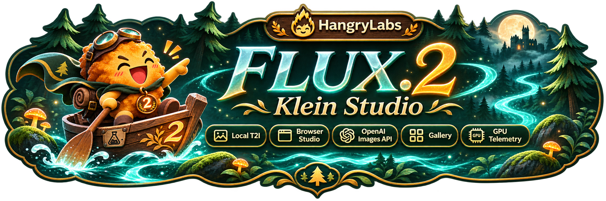

<p align="center"></p>

<p align="center"><a href="README.md">English</a> · <a href="README.nb.md">Norsk bokmål</a> · <a href="README.pl.md">Polski</a> · <strong>日本語</strong> · <a href="README.zh.md">简体中文</a> · <a href="README.es.md">Español</a></p>

# FLUX.2 Klein Studio

FLUX.2 Klein 4B で画像をローカル生成し、指示で編集、緑の領域を補完、クローズアップを作成できます。ブラウザー UI、OpenAI 互換の Images API、MCP を 1 つの Docker コンテナーで提供します。

現在の開発バージョンと変更履歴は、英語のメインドキュメントを参照してください。 [English](README.md#version-history).

## クイックスタート

NVIDIA GPU に対応した Docker と、NVFP4 ランタイムがサポートする Blackwell GPU が必要です。RTX 5070 Ti、VRAM 16 GiB で検証しています。他の GPU はローカル検証していません。大きな画像や追加の参照画像には、より多くのメモリが必要です。

```shell
docker run -d --name flux2-klein-studio --restart unless-stopped --gpus all --init -p 127.0.0.1:7860:7860 -v flux2_klein_studio_data:/app/persistent hangrylabs/flux2-klein-studio:v1.0.0@sha256:276d5a25e347107f0670aad9a6b3a61098d072e504502391fbea8f5575a246ae
```

**http://localhost:7860/ja** を開いてください。上部で表示言語を選べます。言語設定はブラウザーに保存されますが、言語を指定した URL が優先されます。言語の切り替えでは再読み込みせず、テキスト、画像、現在の作業を保持します。

### ダウンロード容量の小さい tiny

```shell
docker run -d --name flux2-klein-studio --restart unless-stopped --gpus all --init -p 127.0.0.1:7860:7860 -v flux2_klein_studio_data:/app/persistent hangrylabs/flux2-klein-studio:v1.0.0_tiny@sha256:0278135ce5fece29da9f6379add9dc2d9c137742dbcea050f9a772f888980c59
```

標準イメージには固定バージョンのメインモデルを含み、イメージ取得後はオフライン生成できます。tiny は初回使用時にモデルと対応カーネルをダウンロードします。どちらか一方を選び、同じデータボリュームを保持してください。スタイルアダプターは初回に別途ダウンロードします。標準イメージでは、最初に `-e STUDIO_OFFLINE=0` でネットワーク読み込みを有効にしてください。

## できること

- テキストから正方形、縦長、横長、パノラマの画像を生成。
- 画像を編集、またはベースモデルで順序付き参照画像を 4 枚まで使用。視点を増やしても外見の完全な一致は保証しません。
- ピクセルアート、Koni Anime、NASA 宇宙コンセプトアートを選択。サーバーが固定トリガーワードを追加するので、画像の説明だけを入力します。
- 純粋な緑（`#00FF00`）で塗って補完したり、キャンバスを拡張。赤枠による生成型ズームは、結果から繰り返せます。
- PNG、可逆 WebP、JPEG でダウンロード。ギャラリーへの任意保存、生成設定の再利用、保存ファイルの削除。
- GPU の状態、モデルの待機時間、エージェントが使える画像サイズを管理。


## 生成と編集

まずは 1024×1024、4 ステップから始めてください。ランダムシードは初期状態でオンです。検証済みの GPU と環境で同じ設定を再現するには、オフにしてシードを固定します。最初のジョブでモデルを読み込み、以降は重みを再利用します。**編集に送る** で結果を参照画像として開き、**この結果を使用** で新しい画像から次の編集を始められます。

緑領域の補完と赤枠ズームは参照画像 1 枚を使用します。選択外の領域が変わったり、細部を新しく作ることがあります。ピクセルアートの背景は RGB で、本当の透過画像ではありません。表示言語を変えても、入力したプロンプトや固定の英語トリガーワードは翻訳しません。すべてのプロンプト言語で同じ画質を保証するものではありません。

## ファイルとメモリ

`flux2_klein_studio_data` ボリュームを `/app/persistent` にマウントし、モデル、キャッシュ、設定、保存結果を保持します。コンテナーを置き換える際も同じボリュームを使ってください。ギャラリー保存を選ばない結果は一時的で、再起動時やプレビュー 100 件の保持枠から外れた時に削除されます。保存した結果は、明示的に削除するまで保持されます。データボリュームを削除すると、キャッシュと保存結果の両方を失う場合があります。

モデルの全コンポーネントを GPU に保持し、CPU やディスクへのオフロードは行いません。既定では最後のジョブから 5 分間、重みを保持します。未使用の作業メモリは自動解放し、System から即時解放もできます。サイズ表はテキストのみの生成の参考測定値であり、すべての編集がメモリに収まる保証ではありません。

## アプリとエージェント

Images API は `/v1/images/generations` と `/v1/images/edits`、モデル名は `flux2-klein-4b` です。MCP は `/mcp/` の Streamable HTTP を使用します。エージェントは最初に `skill` ツールを読んでください。`square_big` などのサイズ名やアダプター ID は変わりません。API は `n=1..16` に対応し、共有 FIFO キューで待機して GPU 上で 1 枚ずつ生成します。以下の例は Bash の引用符を使用しています。

```bash
curl http://localhost:7860/v1/images/generations -H "Content-Type: application/json" -d '{"model":"flux2-klein-4b","prompt":"A glass robot tending orchids in a sunlit greenhouse","size":"square_big","seed":12345}'
```

## ドキュメント

[簡易操作ガイド](docs/ja/README.md) · [Docker Hub](docs/dockerhub.ja.md) · [詳細な英語ドキュメント](docs/README.md).

この日本語の入門ガイドでは日常的な操作を説明します。詳細な API スキーマ、測定レポート、アダプターの生成設定、リリース手順、検証履歴は英語で管理しています。以下のリンクには使用言語を明記しています。

## プライバシーと利用条件

画像生成はローカルで行います。結果とプロンプトの永続保存は、ギャラリー保存を明示的に選んだ場合のみです。初回ダウンロードにはネットワークが必要です。ポートは localhost に制限するか、適切な認証付きプロキシを使ってください。`STUDIO_API_KEY` は `/v1` と `/mcp` を保護し、ローカルのブラウザー API は保護しません。必要な許可を得た参照画像を使用し、生成画像を本物の記録として扱わないでください。

アプリケーションコードは Apache-2.0 です。モデル、アダプター、依存関係にはそれぞれの条件が適用されます。LICENSE、NOTICE、THIRD_PARTY.md を参照してください。アプリのライセンスが各コンポーネントの条件を置き換えることはありません。

[LICENSE](LICENSE) · [NOTICE](NOTICE) · [THIRD_PARTY.md](THIRD_PARTY.md).
