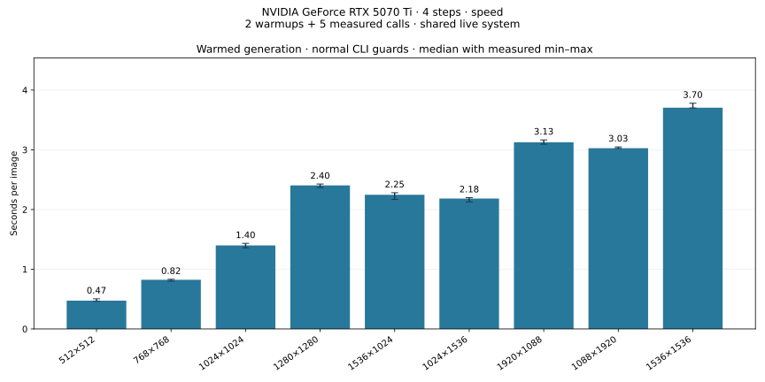

# FLUX.2 Klein Studio

Experimental local text-to-image generation using FLUX.2 Klein 4B with a Nunchaku
Lite NVFP4 rank-32 transformer and an NF4 text encoder. The Docker CLI generates
images at configurable resolutions with all model components on the GPU, without
application offloading. The default image size is 1024×1024.
The local browser studio provides generation, a saved-image gallery, recipe reuse
and GPU telemetry. Product artwork is currently a temporary placeholder.

**Repeatability:** ordered low-rank accumulation is enabled by default. Repeated
prompts and seeds produced pixel-identical images on the tested GPU and pinned
stack, including after restarting the container. Other GPUs and software versions
have not been qualified. See [validation](docs/validation.md#ordered-reduction).

## Run locally

Requires Docker with Compose GPU support and NVIDIA GPU access. The current
image targets Linux x86_64 containers on a Blackwell GPU. Tested on an RTX 5070 Ti
with 16 GiB VRAM; other hardware has not been qualified. Windows requires a Docker
installation configured for Linux containers and NVIDIA GPU passthrough.
See [validation](docs/validation.md) for measured settings and memory use.

Clone the repository, then run these commands in PowerShell or Bash from its root.

Build the development image:

```shell
docker compose build
```

Start the browser studio, then open **http://localhost:7860**:

```shell
docker compose up -d
```

The first generation downloads the pinned model and compatible CUDA kernel when
needed. See the [studio guide](docs/studio.md) for controls, storage and API routes.
The port is bound to loopback for local access.

Or generate an image directly from the CLI:

```shell
docker compose run --rm studio generate --prompt "A glass robot tending orchids in a sunlit greenhouse, cinematic lighting, highly detailed"
```

Images and JSON reports appear under `outputs/<timestamp>/`. Model and kernel
caches live in the `flux2-klein-studio-data` Docker volume and survive container
removal. Keep that volume to avoid downloading the assets again. Removing it,
including with `docker compose down --volumes`, deletes the cached assets.
The image is built locally as `flux2-klein-studio:dev`; no registry image or stable
release is published. The browser service uses port 7860; explicit CLI commands
remain available. Check **Save result to gallery** to retain an image and recipe
under `outputs/studio/`; otherwise the result is a temporary downloadable preview.
System controls the model idle timeout (five minutes by default) and manual unload.

## Runtime commands

Check CUDA and library imports without downloading model weights:

```shell
docker compose run --rm studio doctor
```

Optionally download the model before generation:

```shell
docker compose run --rm studio download
```

Measure warmed generation speed at 1024×1024:

```shell
docker compose run --rm studio benchmark
```

Memory, speed and fixed-seed correctness have separate suites and reports. See
the [benchmark guide](benchmarks/README.md) for methodology, per-size VRAM and
speed tables, fixed-seed results and immutable run history. SVG summary charts
live directly in `benchmarks/`:



[VRAM chart](benchmarks/memory.svg) · [Fixed-seed chart](benchmarks/fixed-seed.svg)

### Task shortcuts

With [Task](https://taskfile.dev/) installed, the repository's `Taskfile.yml`
provides the same commands on PowerShell and Bash. Run `task` to list them.

```shell
task build
task ui
task doctor
task model:download
task generate WIDTH=1536 HEIGHT=1024 -- --prompt "A mountain lake at sunrise"
task benchmark WIDTH=1024 HEIGHT=1024
task bench:memory
task bench:speed
task bench:seed
task bench:full
task bench:capacity
task test:gpu
task lint
```

Performance tasks use cached assets (`--offline`), two warmups and five measured
calls per resolution. Fixed-seed controls run in their own suite. First generate an image to
populate the model and kernel caches. Override `RUNS`, `WARMUPS`, `SEED`, `STEPS`,
`RESOLUTIONS`, `SEED_RESOLUTIONS`, `CAPACITY_RESOLUTIONS` or the per-case `TIMEOUT` as needed.
Capacity testing stops at low sampled free memory, OOM or timeout; unexpected
errors stop the sweep and return a failure. Raw images, logs, JSON and CSV stay
under ignored `outputs/benchmarks/`. Tasks archive portable JSON/CSV snapshots,
update each suite's Markdown reports, and rebuild the root SVGs. Resolution
sweeps start a fresh process for each size; `task benchmark:plan` shows the
workload without GPU access. `task bench:full` runs all three suites sequentially.

Expandable GPU memory segments (`PYTORCH_ALLOC_CONF=expandable_segments:True`)
are enabled by default at every resolution in the CLI, Docker image and Task
commands. This reduced reserved memory in our tests. `doctor` reports the selected
configuration. To compare with PyTorch's original allocator:

```shell
task benchmark ALLOC_CONF=backend:native
docker compose run --rm -e PYTORCH_ALLOC_CONF=backend:native studio benchmark --offline
```

See the benchmark notes before treating a completed size as a comfortable VRAM
fit. `task benchmark:report SUITE=speed` rebuilds the latest speed report and
chart without inference. `task bench:plot` renders a selected JSON using `REPORT`
and `CHART`. Lint, formatting and plotting use a separate
small tools image, without adding development dependencies to the inference image.
`task docker:down` preserves the model volume.

## What the settings mean

- **Prompt:** the written description of the picture.
- **Seed:** the starting randomness. Default: `12345`. Tested with exact
  repeatability in ordered mode on the same GPU and stack. Hardware/software
  changes can change the result; keep the image and metadata.
- **Steps:** rounds of image refinement. This packaged model's initial profile
  uses four steps; more steps are not automatically better for a distilled model.
- **NVFP4 / NF4:** different four-bit weight formats used by the transformer and
  text encoder. Other parts and computations still use higher precision.
- **Rank 32:** part of the transformer checkpoint's quantization design, not an
  image-quality slider or a LoRA strength setting.
- **Offloading:** moving model components between GPU and host memory to save
  VRAM. This profile keeps them on the GPU and fails rather than enabling offload.

Batch size is one and guidance is `1.0`. `--width` and `--height` must each be at
least 64 and divisible by 16; invalid sizes are rejected instead of silently
rounded. For example, use 1920×1088 rather than 1920×1080. `--seed`, `--steps`,
`--prompt` and `--output-dir` can also be changed. Direct `benchmark`, `memory`
and `seed-test` default to two warmups and five measured calls; use `--warmups`
and `--runs` to override them. Performance calls rotate three prompts and vary
seeds deterministically. `--prompt` selects one custom prompt instead. `seed-test`
repeats one prompt/seed, then checks a second seed and a changed prompt. The
fixed-seed resolution sweep additionally verifies reproduction in a fresh process.
Changing the dimensions changes the starting noise layout and composition,
even when the seed is the same; repetition is checked within each resolution.

Ordered mode uses a GPU kernel with a fixed accumulation order for the low-rank
correction. It preserves the model weights, NF4 encoder and no-offload profile.
The first call compiles small Triton kernels; their cache is kept in the data
volume. The image includes the required compiler. It does not require a host
CUDA toolkit.

For comparison with the original kernel, use `--reduction native`. Native mode
was observed to produce different pixels with identical prompts and seeds:

```shell
docker compose run --rm studio seed-test --offline --reduction native
```

This correctness check is expected to fail if the original kernel varies; use
`benchmark --reduction native` separately to measure its speed.

After one successful inference has populated both caches, use `--offline` with
`generate`, `benchmark`, `memory` or `seed-test` for cached loading. Verify complete offline operation
with Docker's network disabled, as described in the validation notes.

Model weights are downloaded into the volume, not bundled into the image. The
runtime explicitly permits code from the pinned Nunchaku kernel repository through
`DIFFUSERS_TRUST_REMOTE_KERNELS=true`. It checks the expected kernel revision and
fails if the upstream version reference changes; dependency updates need validation.

## Development and attribution

```shell
docker build --target test -t flux2-klein-studio:test .
```

The test stage runs CPU tests for the residency and quantization guards; actual
GPU generation requires the runtime checks above. Sweep tests also cover input
validation, failure reporting and stopping at capacity limits. Dependency pins are in
`requirements.txt`, with the full Linux dependency resolution in `requirements.lock`;
validation records the selected model/kernel revisions and loaded kernel file hashes.
To update the lock, use `uv pip compile requirements.txt --python-version 3.13 --python-platform x86_64-unknown-linux-gnu --index-strategy unsafe-best-match --emit-index-url --output-file requirements.lock`,
then rebuild and repeat the GPU checks. The lock targets the Linux container,
not the host operating system.

Run the GPU numerical tests, including padded shapes and comparison against a
float64 reference, after building the test image:

```shell
docker run --rm --gpus all --mount type=volume,source=flux2-klein-studio-data,target=/data --entrypoint python flux2-klein-studio:test -m unittest discover -s tests -v
```

Model: [lite-infer/flux.2-klein-4b-nunchaku-lite-nvfp4-r32](https://huggingface.co/lite-infer/flux.2-klein-4b-nunchaku-lite-nvfp4-r32),
based on Black Forest Labs FLUX.2 Klein 4B. Runtime: Hugging Face Diffusers,
Transformers, bitsandbytes and Nunchaku Lite CUDA kernels. See
[third-party notices](THIRD_PARTY.md).

Inference runs locally. Initial installation and model/kernel acquisition require
network access; prompts are not sent to a hosted image-generation service. Avoid
misleading impersonation and obtain permission for private or identifying material.
Generated images can contain errors and do not establish that a depicted event occurred.
