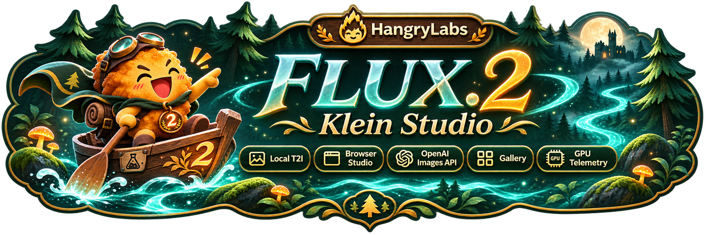
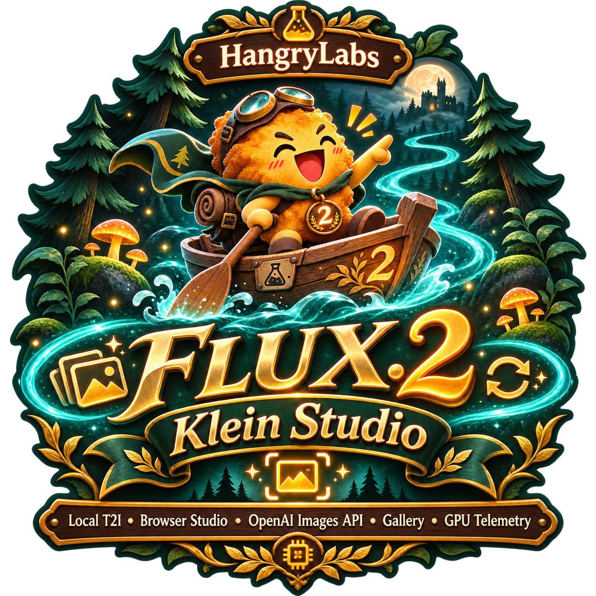
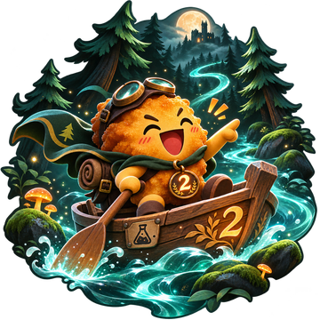
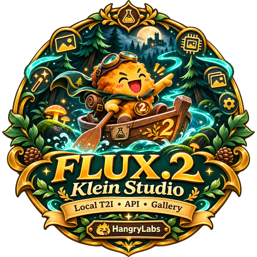

# Project artwork

Product artwork supplied for FLUX.2 Klein Studio. The full-resolution WebP images
below retain the original pixels and transparency. PNG originals were removed
after verifying lossless conversion. Filenames consistently use `flux2_klein`.

| Asset | Preview | Use |
| --- | --- | --- |
| [Horizontal logo](flux2_klein_logo_horizontal.webp) |  | Expanded studio header and README |
| [Full logo](flux2_klein_logo.webp) |  | Portrait product artwork for documentation and project cards |
| [Mascot](flux2_klein_mascot.webp) |  | Empty generation canvas |
| [Badge](flux2_klein_badge.webp) |  | Subtle header backdrop |

[flux2_klein_favicon.webp](flux2_klein_favicon.webp) is a 192-pixel thumbnail of the
mascot, used for the browser tab and compact header. The separate
[Hangry Labs logo](hangrylabs_logo.webp) remains the studio's linked signature.

Smaller display copies live in [ui/](ui/): header at 1440×480, mascot at 360×360
and badge at 512×512. They use the same artwork with transparency preserved.
The app serves these files at `/assets/`; Docker packages them directly from this
folder, keeping the repository's artwork in one visible place.
