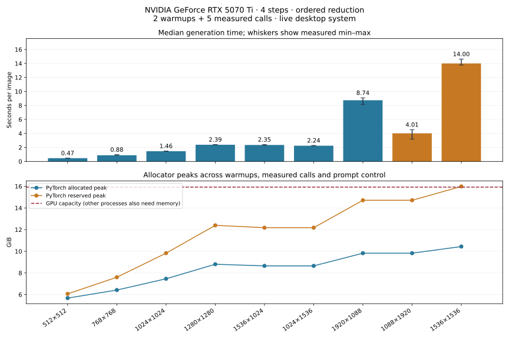
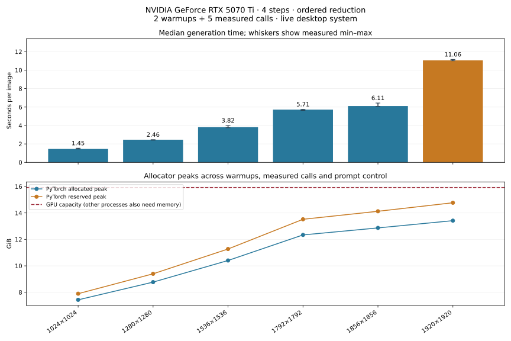

# Historical allocator and resolution comparison

Measured on 2026-11-05 using an RTX 5070 Ti, driver 610.88, Docker Desktop Linux
containers and the pinned CUDA 13.0 / PyTorch 2.14.0 stack. This is a live desktop
system. Small timing differences between runs are noise; these measurements do
not establish a throughput service-level guarantee.

## Method

- Batch size one, four steps, guidance 1.0, seed 12345 and the default greenhouse
  prompt. Ordered reduction, NVFP4 rank-32 transformer and NF4 text encoder.
- Each resolution gets a fresh Python/CUDA process, two warmups, five measured
  same-prompt calls and one changed-prompt control. The exploratory capacity run
  uses one warmup and three measured calls and is identified separately.
- Timings include tokenization, text encoding, denoising, VAE decoding and device
  synchronization. They exclude model loading, PNG writing and container startup.
  Warmups are excluded from median/min/max. First-call time is reported separately
  and can include compilation; the persistent compiler cache was already populated
  for some shapes. It is not a clean-cache compile benchmark.
- JSON/CSV record median, mean, population standard deviation, min/max, allocator
  peaks and sampled whole-device memory. Memory peaks include warmups and the
  changed-prompt control. Whole-device samples include other applications and can
  miss short peaks; allocated/reserved peaks come from PyTorch's own counters.
- CUDA placement and quantization are checked after loading and after every call.
  Application offload, VAE tiling and VAE slicing are disabled. CUDA placement
  alone cannot rule out driver-managed paging under Windows memory pressure.
- A completed case must have the requested output size, nonblank pixels, finite
  latents, exact same-seed pixel hashes and a materially different prompt control.
  This checks operational behavior, rather than aesthetic quality at each size.

Higher resolution uses more activation and decoding memory even though model
weight size stays the same. **Allocated** memory belongs to active tensors;
**reserved** memory also includes blocks PyTorch keeps for reuse. Neither number
includes every driver allocation or another application's memory. Driver-managed
paging is a possible explanation for the large-size slowdown below, rather than
a measured paging counter.

## Original allocator baseline

The original native allocator was retained for this historical sweep. Every size
completed eight calls and repeated same-seed pixels exactly.

| Resolution | Megapixels | Median seconds | Practical observation |
| --- | ---: | ---: | --- |
| 512×512 | 0.26 | 0.47 | Comfortable in this run |
| 768×768 | 0.59 | 0.88 | Comfortable in this run |
| 1024×1024 | 1.05 | 1.46 | Original target |
| 1280×1280 | 1.64 | 2.39 | Comfortable in this run |
| 1536×1024 | 1.57 | 2.35 | Landscape |
| 1024×1536 | 1.57 | 2.24 | Portrait |
| 1920×1088 | 2.09 | 8.74 | Memory pressure, large slowdown |
| 1088×1920 | 2.09 | 4.01 | Memory pressure, variable timing |
| 1536×1536 | 2.36 | 14.00 | Memory pressure, large slowdown |

At 1536 square, peak allocated memory was about 10.44 GiB while reserved memory
reached 15.99 GiB, above the 15.92 GiB capacity reported to CUDA, before accounting
for other applications. A successful call here is insufficient evidence of a
comfortable physical-VRAM fit. Native allocator sizes above 1536 square were not
part of this initial nine-size sweep.

Data: [JSON](resolution-baseline.json) and
[CSV](resolution-baseline.csv). The first sweep's headroom counter
used total minus used memory, which excludes driver-reserved memory. Its exported
field is explicitly named `sampled_device_total_minus_peak_used_mib`; do not read
it as actual free memory or compare it directly with the newer free-memory field.
The sampler was corrected to read `nvidia-smi memory.free` for subsequent runs.

## Expandable-segment profile

This profile was measured separately and has since become the default at every
resolution in the CLI, Docker image and Task commands. The model is unchanged.
PyTorch's experimental `expandable_segments:True` setting can
reduce unusable slices in reserved allocation segments; see the
[PyTorch memory-management documentation](https://docs.pytorch.org/docs/2.14/notes/cuda.html#optimizing-memory-usage-with-pytorch-alloc-conf).
It does not enable application offloading or VAE tiling.

| Resolution | Median seconds (min–max) | Allocated / reserved peak, GiB | Minimum sampled free MiB |
| --- | ---: | ---: | ---: |
| 1024×1024 | 1.45 (1.45–1.54) | 7.43 / 7.89 | 7044 |
| 1280×1280 | 2.46 (2.41–2.46) | 8.77 / 9.40 | 5501 |
| 1536×1536 | 3.82 (3.75–4.00) | 10.40 / 11.27 | 3581 |
| 1792×1792 | 5.71 (5.64–5.75) | 12.34 / 13.52 | 1281 |
| 1856×1856 | 6.11 (6.08–6.43) | 12.87 / 14.12 | 661 |
| 1920×1920 | 11.06 (11.02–11.16) | 13.42 / 14.77 | 91 |

All six sizes completed eight calls and retained exact same-seed equality. At
1536 square, reserving less memory coincided with a change from 14.00 to 3.82
seconds, while small-size latency stayed broadly similar. These are sequential
live-system runs, rather than a controlled paired experiment. Do not attribute
small timing changes to the allocator alone. The larger memory-pressure cliff is
the useful operational finding.

**Practical baseline:** 1792 square offers more breathing room. **1856 square was
the highest tested square above the 512 MiB sampled-free threshold**, with only
661 MiB remaining. **1920 square completed but crossed that threshold** and
slowed substantially. These bounds apply to this prompt and workload, not every
possible input or a theoretical maximum dimension. Intermediate dimensions were
not exhaustively searched. Default-allocator square runs above 1280 had less
headroom, so the larger-size recommendation applies to the current expandable-segment default.

An earlier exploratory run (one warmup, three measured calls) also passed 1280,
1536 and 1792 square. **2048 square failed during the first warmup**, with
`RuntimeError: CUDA driver error: device not ready` and `Failed to create GPU mapping`.
No image completed. This is a recorded CUDA mapping failure, not a confirmed
ordinary OOM and not a supported resolution. Its partial memory counters do not
represent the memory a completed 2048 image would require.

Data: [five-call JSON](resolution-expandable.json),
[CSV](resolution-expandable.csv), and
[exploratory capacity JSON](resolution-capacity-exploration.json) /
[CSV](resolution-capacity-exploration.csv). The failed exploratory
sweep retains `status: failed`; it has not been relabeled as a successful benchmark.
All sampler values in these two profiles use actual reported free memory.

After enabling this profile by default, a fresh Task sweep at 512, 1024 and 1536
square passed one warmup, three measured calls and the prompt control per size,
retaining exact same-seed pixels. All 14 GPU-enabled tests passed with the new
default. The historical tables above retain their original measurements.

## Historical evidence

These combined runs preceded the separate memory, speed and fixed-seed suites.
Their JSON/CSV and original charts are preserved without changing measurements.
Current commands and methodology are in [the benchmark guide](../../README.md).
The old first-push and ordered-reduction evidence is in [initial history](../initial/).
