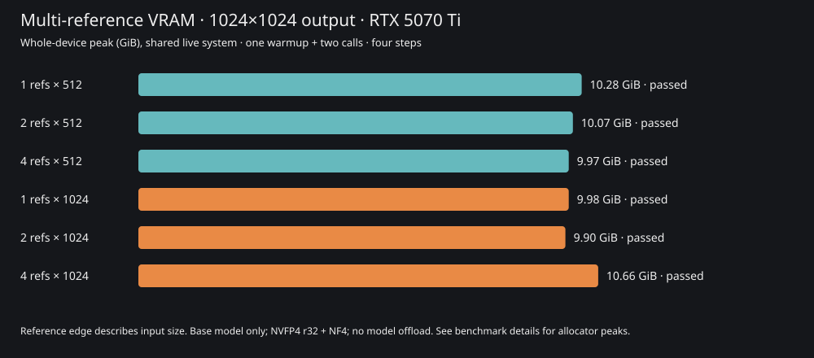

# Multiple reference images

Output remains **1024×1024**, four steps, seed12345, base-model editing without
LoRAs. These measurements compare one, two and four reference pictures. Input
edges512/1024 describe conditioning detail, not new output-resolution benchmarks.

- [Memory history](memory/gpu/BENCHMARKS.md) · [Latest details](memory/gpu/DETAILS.md)
- [Quality/repeat history](quality/BENCHMARKS.md) · [Latest details](quality/DETAILS.md)
- [Root VRAM chart](../multiref-memory.svg)



The reference set is a generated fictional adult man: front, profile,
three-quarter and full-body views. The request places the same person at a cafe
in a green jacket. Source images and results stay in ignored local output folders.
Input pixel hashes, prompts, seed, configuration and per-call records are archived
in the public JSON. There are no private photographs or model weights in these reports.

Visual review found recognizable red hair, freckles, glasses and ear studs across
the one/two/four-reference results. All looked broadly consistent with the source;
this small example does **not** establish that four references are better than
one, nor exact identity preservation on real photographs. Four-reference repeat
pixels matched on the tested GPU/stack. No biometric score was measured.

## Reproduce

Build the current image and cache the main model first. Unload the studio model
and wait for its queue to empty before running a separate measurement container.
Leave unrelated services alone; this is shared live-system evidence.

```shell
task build
task refine:references:plan
task refine:references:fixtures
task refine:references:memory
task refine:references:quality -- --edge 1024
```

The fixtures task uses the same quantized model to generate four synthetic views;
it is not a measurement suite. For another reference set, forward four repeated
`--reference /app/persistent/outputs/path.png` arguments. Memory uses a fresh worker per
count/edge profile, one warmup and two measured calls. Loading, warmup and warmed
generation stages are separate. Whole-device polling targets100ms and includes
the desktop and other processes; PyTorch allocated/reserved peaks are independent
counters. Raw samples, logs and images remain under `outputs/multiref/`.
The first pilot retained stage summaries only; later runs retain telemetry timelines
and capture the harness fingerprint in each worker. No speed suite was requested;
memory-sampled call durations are not presented as generation-speed benchmarks.

Regenerate reports without GPU work:

```shell
python tools/report_multiref.py outputs/multiref/memory-RUN/summary.json
python tools/report_multiref.py outputs/multiref/quality-RUN/summary.json
```

Or use `task refine:references:report REFERENCE_REPORT=outputs/multiref/memory-RUN/summary.json`.
For the quality plan, run `task refine:references:plan REFERENCE_SUITE=quality`.

Archives refuse changed evidence and the root chart follows the latest memory
run. OOMs/timeouts remain failures. A measured free-memory margin is workload-specific;
all-GPU tensor placement does not rule out driver-managed paging on another load.
