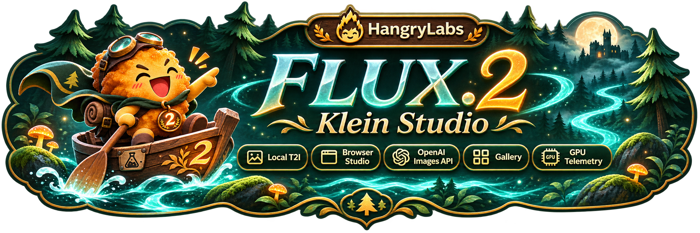

<p align="center"></p>

<p align="center"><a href="https://github.com/hangry-labs/flux2-klein-studio/blob/main/docs/dockerhub.md">English</a> · <a href="https://github.com/hangry-labs/flux2-klein-studio/blob/main/docs/dockerhub.nb.md">Norsk bokmål</a> · <a href="https://github.com/hangry-labs/flux2-klein-studio/blob/main/docs/dockerhub.pl.md">Polski</a> · <a href="https://github.com/hangry-labs/flux2-klein-studio/blob/main/docs/dockerhub.ja.md">日本語</a> · <a href="https://github.com/hangry-labs/flux2-klein-studio/blob/main/docs/dockerhub.zh.md">简体中文</a> · <strong>Español</strong></p>

# FLUX.2 Klein Studio

Genera imágenes localmente con FLUX.2 Klein 4B, edítalas mediante instrucciones, rellena zonas verdes y crea primeros planos. Interfaz de navegador, API de imágenes compatible con OpenAI y MCP en un contenedor Docker.

Consulta la documentación principal en inglés para la versión de desarrollo y el historial de cambios actuales. [English](https://github.com/hangry-labs/flux2-klein-studio/blob/main/README.md#version-history).

## Inicio rápido

Requiere Docker con soporte de GPU NVIDIA y una GPU Blackwell compatible con el entorno NVFP4. Probado en una RTX 5070 Ti con 16 GiB de VRAM; otras GPU no están verificadas localmente. Las imágenes grandes y las referencias adicionales necesitan más memoria.

```shell
docker run -d --name flux2-klein-studio --restart unless-stopped --gpus all --init -p 127.0.0.1:7860:7860 -v flux2_klein_studio_data:/app/persistent hangrylabs/flux2-klein-studio:latest
```

Abre **http://localhost:7860/es**. Elige el idioma de la interfaz en la parte superior. El navegador recuerda la preferencia, pero una URL de idioma explícita tiene prioridad. Cambiar de idioma no recarga la página y conserva texto, imágenes y trabajo actual.

### Descarga menor: tiny

```shell
docker run -d --name flux2-klein-studio --restart unless-stopped --gpus all --init -p 127.0.0.1:7860:7860 -v flux2_klein_studio_data:/app/persistent hangrylabs/flux2-klein-studio:latest_tiny
```

La imagen estándar incluye el modelo principal fijado y permite generar sin conexión tras descargarla. Tiny descarga el modelo y los kernels compatibles en el primer uso. Elige una variante y conserva el mismo volumen. Los adaptadores se descargan por separado al usarlos por primera vez; en la imagen estándar activa antes las descargas con `-e STUDIO_OFFLINE=0`.

## Qué puedes hacer

- Generar desde descripciones con formatos cuadrados, verticales, horizontales y panorámicos.
- Editar una imagen o usar hasta cuatro referencias ordenadas con el modelo base. Más vistas no garantizan un parecido exacto.
- Elegir Pixel Art, Koni Anime o arte conceptual espacial NASA. El servidor añade los activadores fijos; tú describes la imagen.
- Pintar con verde puro (`#00FF00`) para rellenar o ampliar el lienzo. Un rectángulo rojo permite hacer zoom generativo y continuar desde el resultado.
- Descargar PNG, WebP sin pérdida o JPEG. Guardar opcionalmente en Galería, reutilizar ajustes y borrar los archivos guardados.
- Ver el uso de GPU, ajustar la inactividad del modelo y controlar los tamaños disponibles para agentes.


## Generación y edición

Empieza con 1024×1024 y cuatro pasos. La semilla aleatoria está activada inicialmente; desactívala para repetir una semilla con los mismos ajustes en la GPU y el entorno verificados. El primer trabajo carga el modelo y los siguientes reutilizan sus pesos. **Enviar a edición** abre el resultado como referencia. **Usar este resultado** inicia otra pasada desde la nueva imagen.

Relleno verde y Zoom rojo usan una sola referencia. También pueden cambiar zonas no marcadas e inventar detalles. Pixel Art produce un fondo RGB, no transparencia real. El idioma de la interfaz no traduce tu descripción ni los activadores fijos en inglés, ni garantiza la misma calidad con todos los idiomas de prompt.

## Archivos y memoria

El volumen `flux2_klein_studio_data`, montado en `/app/persistent`, conserva modelos, cachés, ajustes y resultados guardados. Reutilízalo al reemplazar el contenedor. Sin guardar en Galería, el resultado es temporal: se elimina al reiniciar o al salir del conjunto de 100 vistas previas. Los resultados guardados solo se eliminan cuando tú los borras. Eliminar el volumen puede borrar tanto la caché como los resultados guardados.

Todos los componentes del modelo permanecen en GPU, sin descarga a CPU o disco. Los pesos se conservan cinco minutos tras el último trabajo de forma predeterminada. La memoria de trabajo sin usar se libera automáticamente; Sistema también permite liberarla al instante. La tabla de tamaños muestra referencias de generación solo con texto, no una garantía de que todas las ediciones quepan en memoria.

## Aplicaciones y agentes

Images API: `/v1` · MCP: `/mcp/` · [Guía breve de uso](https://github.com/hangry-labs/flux2-klein-studio/blob/main/docs/es/README.md).

## Privacidad y condiciones

La generación se realiza localmente. Los resultados y prompts solo se guardan de forma persistente al elegir Galería; la descarga inicial necesita red. Mantén el puerto en localhost o usa un proxy con autenticación adecuada. `STUDIO_API_KEY` protege `/v1` y `/mcp`, no la API local del navegador. Usa referencias con los permisos necesarios y no presentes imágenes generadas como registros auténticos.

El código de la aplicación tiene licencia Apache-2.0. Modelos, adaptadores y dependencias conservan sus propias condiciones. Consulta LICENSE, NOTICE y THIRD_PARTY.md; la licencia de la aplicación no sustituye las condiciones de los componentes.

[Resumen del proyecto](https://github.com/hangry-labs/flux2-klein-studio/blob/main/README.es.md) · [Documentación](https://github.com/hangry-labs/flux2-klein-studio/blob/main/docs/es/README.md) · [LICENSE](https://github.com/hangry-labs/flux2-klein-studio/blob/main/LICENSE) · [NOTICE](https://github.com/hangry-labs/flux2-klein-studio/blob/main/NOTICE) · [THIRD_PARTY.md](https://github.com/hangry-labs/flux2-klein-studio/blob/main/THIRD_PARTY.md).
