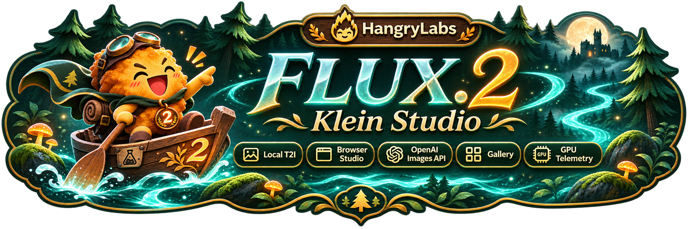
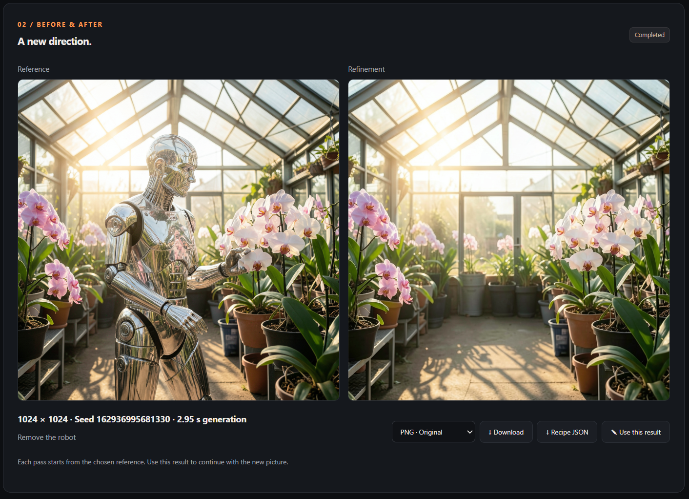

<p align="center">
  
</p>

# FLUX.2 Klein Studio

Create pictures, refine them with instructions, fill painted areas and explore
close-ups—all locally, in your browser. Connect apps and AI agents through the
Images API and MCP.

## Quick start

With Docker and NVIDIA GPU support installed, run:

```shell
docker run -d --name flux2-klein-studio --restart unless-stopped --gpus all --init -p 127.0.0.1:7860:7860 -v flux2_klein_studio_data:/app/persistent hangrylabs/flux2-klein-studio:latest
```

Open **http://localhost:7860**. Write a description and click **Generate image**.
The first generation loads the model; later requests reuse it while it stays loaded.

The standard image includes the main model for offline generation. For a smaller
download, replace `:latest` with `:latest_tiny`; it downloads the model on first
use. Both use the same persistent volume. Choose either variant.

**Hardware:** an NVIDIA Blackwell GPU or newer is required by this model's NVFP4
runtime. The development setup uses an RTX 5070 Ti with 16 GB VRAM. Larger images
and additional references need more memory. Windows uses Docker Desktop with GPU
support; Linux needs NVIDIA Container Toolkit.

## What you can do

- **Generate** images from descriptions, with square, portrait and landscape sizes.
- **Refine** a picture: change lighting, objects, backgrounds or composition.
- **Use up to four reference pictures** to guide the subject and scene, then edit each result further.
- **Choose a style:** Pixel Art sprites, Koni Anime or NASA retro space concept art.
- **Fill or extend a picture** by painting green areas in Refine.
- **Zoom into a selected area**, move the selection and use the result to zoom again.
- **Save selected results to Gallery**, reopen recipes, download PNG/WebP/JPEG and delete unwanted files.
- **Connect apps and agents** with an OpenAI-compatible Images API and MCP, including queued requests.
- **Control GPU residency** and enabled agent image sizes in System.

Style adapters download on first use. On the standard image, enable network
loading once with `-e STUDIO_OFFLINE=0` to cache a new adapter; the tiny variant
already allows downloads. Picture generation runs locally.

## See it in action

### Change a picture with an instruction

Send a generated image to **Refine**, describe the change and compare the result
beside its reference. Continue with **Use this result** for another pass.


### Remove an object and fill its background



Green Fill and Red Zoom provide additional editing workflows. They generate new
pixels, so details may change. Pixel Art's green background is not transparency;
automatic background removal is not included.

## Keep your work

Reuse `flux2_klein_studio_data`, mounted at `/app/persistent`, when replacing the container. It stores cached
models, settings and images explicitly saved to Gallery. Keep **Save result to
gallery** unchecked for temporary previews. Download anything you want to keep.
Deleting the volume removes its saved contents.

## Apps and agents

Use **http://localhost:7860/v1** for the Images API and
**http://localhost:7860/mcp/** for MCP. Agents can call `skill` first to discover
supported workflows and styles. Named image sizes make requests easy to choose;
concurrent requests wait while the GPU processes one image at a time.

The start command exposes the studio only on this computer. For remote access,
configure authentication and allowed hosts using the
[deployment guide](https://github.com/hangry-labs/flux2-klein-studio/blob/main/docs/agent-api.md).

## Images and updates

| Image | What it includes |
| --- | --- |
| `hangrylabs/flux2-klein-studio:latest` | Standard image with the main model included |
| `hangrylabs/flux2-klein-studio:latest_tiny` | Same application; downloads the model on first use |

Also available from `ghcr.io/hangry-labs/flux2-klein-studio` with the same tags.
Rolling tags follow published development builds. Features shown here follow the
current source; local changes appear in registry images after publication.

**Publication status:** rolling `latest` and `latest_tiny` images are published. See the repository's release history for versioned releases and build details.

[Source and full guide](https://github.com/hangry-labs/flux2-klein-studio) ·
[Studio guide](https://github.com/hangry-labs/flux2-klein-studio/blob/main/docs/studio.md) ·
[Measured GPU requirements](https://github.com/hangry-labs/flux2-klein-studio/blob/main/benchmarks/README.md) ·
[Apache-2.0 and third-party notices](https://github.com/hangry-labs/flux2-klein-studio/blob/main/THIRD_PARTY.md)
