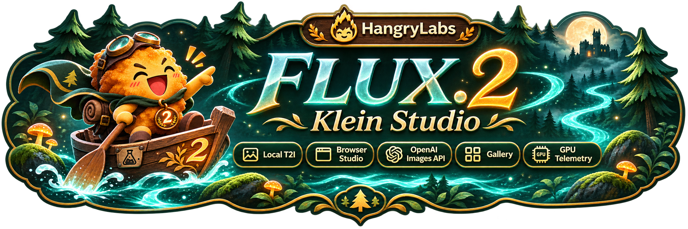
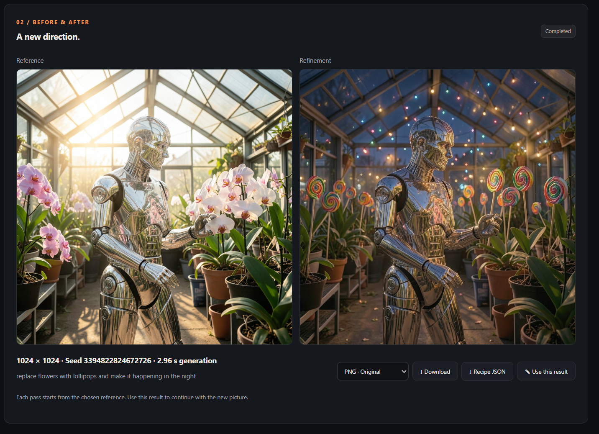

<p align="center"></p>

<p align="center"><a href="https://github.com/hangry-labs/flux2-klein-studio/blob/main/docs/dockerhub.md">English</a> · <strong>Norsk bokmål</strong> · <a href="https://github.com/hangry-labs/flux2-klein-studio/blob/main/docs/dockerhub.pl.md">Polski</a> · <a href="https://github.com/hangry-labs/flux2-klein-studio/blob/main/docs/dockerhub.ja.md">日本語</a> · <a href="https://github.com/hangry-labs/flux2-klein-studio/blob/main/docs/dockerhub.zh.md">简体中文</a> · <a href="https://github.com/hangry-labs/flux2-klein-studio/blob/main/docs/dockerhub.es.md">Español</a></p>

# FLUX.2 Klein Studio

Lag bilder lokalt med FLUX.2 Klein 4B, bearbeid dem med instruksjoner, fyll grønne områder og lag nærbilder. Nettlesergrensesnitt, OpenAI-kompatibelt Images-API og MCP i én Docker-container.

Se hoveddokumentasjonen på engelsk for gjeldende utviklingsversjon og versjonshistorikk. [English](https://github.com/hangry-labs/flux2-klein-studio/blob/main/README.md#version-history).

## Kom raskt i gang

Krever Docker med NVIDIA GPU-støtte og en Blackwell-GPU som støttes av NVFP4-kjøremiljøet. Testet på RTX 5070 Ti med 16 GiB VRAM; andre GPU-er er ikke kvalifisert lokalt. Større bilder og flere referanser krever mer minne.

```shell
docker run -d --name flux2-klein-studio --restart unless-stopped --gpus all --init -p 127.0.0.1:7860:7860 -v flux2_klein_studio_data:/app/persistent hangrylabs/flux2-klein-studio:latest
```

Åpne **http://localhost:7860/nb**. Velg grensesnittspråk øverst. Språkvalget huskes i nettleseren; et direkte språklig URL-valg har forrang. Språkbytte laster ikke siden på nytt og beholder tekst, bilder og gjeldende arbeid.

### Mindre nedlasting: tiny

```shell
docker run -d --name flux2-klein-studio --restart unless-stopped --gpus all --init -p 127.0.0.1:7860:7860 -v flux2_klein_studio_data:/app/persistent hangrylabs/flux2-klein-studio:latest_tiny
```

Standardbildet inneholder den fastlåste hovedmodellen og kan generere frakoblet etter nedlasting. Tiny laster ned modell og kompatible kjerner ved første bruk. Velg én variant og behold samme datavolum. Stiladaptere lastes ned separat ved første bruk; på standardbildet må du først aktivere nettlasting med `-e STUDIO_OFFLINE=0`.

## Dette kan du gjøre

- Generer fra beskrivelser med kvadratiske, stående, liggende og panoramiske formater.
- Bearbeid et bilde, eller bruk opptil fire ordnede referanser med grunnmodellen. Flere vinkler garanterer ikke identisk utseende.
- Velg Pikselkunst, Koni Anime eller NASA-romkonseptkunst. Serveren legger til faste utløserord; du beskriver bildet.
- Mal områder rent grønne (`#00FF00`) for utfylling eller utvid lerretet. Bruk et rødt rektangel for generativ zoom, og fortsett fra resultatet.
- Last ned PNG, tapsfri WebP eller JPEG. Lagre frivillig i galleriet, gjenbruk innstillinger og slett lagrede filer.
- Se GPU-bruk, juster modellens ledighetstid og velg hvilke bildestørrelser agenter kan bruke.



## Generering og bearbeiding

Start på 1024×1024 og fire trinn. Tilfeldig frø er på som standard; slå det av for å gjenta et frø med samme innstillinger på den kvalifiserte GPU-en og programvarestakken. Første jobb laster modellen, mens senere jobber gjenbruker vektene. **Send til bearbeiding** åpner resultatet som referanse. **Bruk dette resultatet** starter neste runde fra det nye bildet.

Grønn utfylling og rød zoom bruker én referanse. De kan endre også umarkerte områder og finne på detaljer. Pikselkunst har RGB-bakgrunn, ikke ekte gjennomsiktighet. Grensesnittspråket oversetter ikke beskrivelsen din eller modellens faste engelske utløserord, og lover ikke lik bildekvalitet for alle beskrivelsesspråk.

## Filer og minne

Volumet `flux2_klein_studio_data` monteres på `/app/persistent` og beholder modeller, hurtigbuffer, innstillinger og lagrede resultater. Gjenbruk det når containeren byttes. Uten avkrysning for gallerilagring er resultatet midlertidig; det forsvinner ved omstart eller når grensen på 100 forhåndsvisninger nås. Lagrede resultater fjernes bare når du sletter dem. Sletting av datavolumet kan slette både hurtigbuffer og lagrede resultater.

Alle modellkomponenter ligger på GPU-en, uten avlasting til CPU eller disk. Vekter beholdes som standard i fem minutter etter siste jobb. Ubrukt arbeidsminne frigis automatisk; System tilbyr også umiddelbar frigjøring. Størrelsestabellen viser målte referanseverdier for generering uten bilder, ikke et løfte om at alle redigeringer får plass.

## Apper og agenter

Images API: `/v1` · MCP: `/mcp/` · [Kort brukerveiledning](https://github.com/hangry-labs/flux2-klein-studio/blob/main/docs/nb/README.md).

## Personvern og vilkår

Generering skjer lokalt. Bare eksplisitt valgt gallerilagring beholder resultater og beskrivelser; første nedlasting trenger nettverk. Hold porten på localhost eller bruk et egnet autentisert mellomlag. `STUDIO_API_KEY` beskytter `/v1` og `/mcp`, ikke det lokale nettleser-API-et. Bruk referansebilder med nødvendige tillatelser og ikke framstill genererte bilder som ekte dokumentasjon.

Programkoden er Apache-2.0. Modeller, adaptere og avhengigheter beholder egne vilkår. Se LICENSE, NOTICE og THIRD_PARTY.md; programlisensen erstatter ikke komponentvilkårene.

[Prosjektoversikt](https://github.com/hangry-labs/flux2-klein-studio/blob/main/README.nb.md) · [Dokumentasjon](https://github.com/hangry-labs/flux2-klein-studio/blob/main/docs/nb/README.md) · [LICENSE](https://github.com/hangry-labs/flux2-klein-studio/blob/main/LICENSE) · [NOTICE](https://github.com/hangry-labs/flux2-klein-studio/blob/main/NOTICE) · [THIRD_PARTY.md](https://github.com/hangry-labs/flux2-klein-studio/blob/main/THIRD_PARTY.md).
