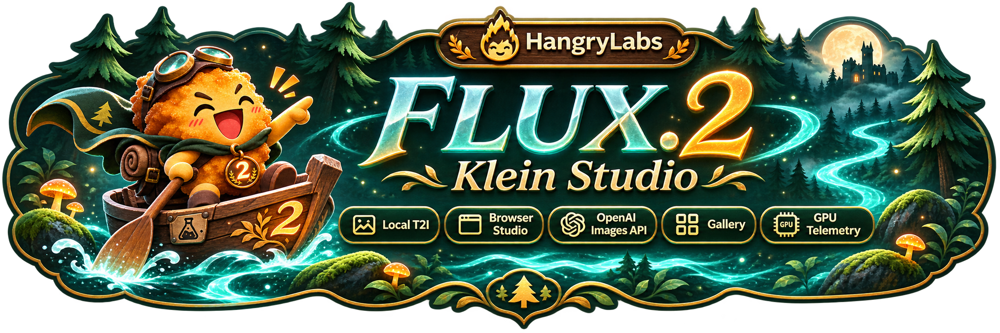

<p align="center"></p>

<p align="center"><a href="https://github.com/hangry-labs/flux2-klein-studio/blob/main/docs/dockerhub.md">English</a> · <a href="https://github.com/hangry-labs/flux2-klein-studio/blob/main/docs/dockerhub.nb.md">Norsk bokmål</a> · <strong>Polski</strong> · <a href="https://github.com/hangry-labs/flux2-klein-studio/blob/main/docs/dockerhub.ja.md">日本語</a> · <a href="https://github.com/hangry-labs/flux2-klein-studio/blob/main/docs/dockerhub.zh.md">简体中文</a> · <a href="https://github.com/hangry-labs/flux2-klein-studio/blob/main/docs/dockerhub.es.md">Español</a></p>

# FLUX.2 Klein Studio

Generuj obrazy lokalnie za pomocą FLUX.2 Klein 4B, edytuj je instrukcjami, wypełniaj zielone obszary i twórz zbliżenia. Interfejs przeglądarkowy, API obrazów zgodne z OpenAI i MCP w jednym kontenerze Docker.

Aktualną wersję rozwojową i historię zmian znajdziesz w głównej dokumentacji angielskiej. [English](https://github.com/hangry-labs/flux2-klein-studio/blob/main/README.md#version-history).

## Szybki start

Wymagany jest Docker z obsługą GPU NVIDIA oraz GPU Blackwell obsługiwane przez środowisko NVFP4. Testujemy RTX 5070 Ti z 16 GiB VRAM; inne GPU nie zostały lokalnie zweryfikowane. Większe obrazy i dodatkowe referencje wymagają więcej pamięci.

```shell
docker run -d --name flux2-klein-studio --restart unless-stopped --gpus all --init -p 127.0.0.1:7860:7860 -v flux2_klein_studio_data:/app/persistent hangrylabs/flux2-klein-studio:v1.0.0@sha256:276d5a25e347107f0670aad9a6b3a61098d072e504502391fbea8f5575a246ae
```

Otwórz **http://localhost:7860/pl**. Język interfejsu wybierzesz u góry. Przeglądarka go zapamięta; bezpośredni adres języka ma pierwszeństwo. Zmiana języka nie odświeża strony i zachowuje tekst, obrazy oraz bieżącą pracę.

### Mniejsze pobieranie: tiny

```shell
docker run -d --name flux2-klein-studio --restart unless-stopped --gpus all --init -p 127.0.0.1:7860:7860 -v flux2_klein_studio_data:/app/persistent hangrylabs/flux2-klein-studio:v1.0.0_tiny@sha256:0278135ce5fece29da9f6379add9dc2d9c137742dbcea050f9a772f888980c59
```

Standardowy obraz zawiera przypięty model bazowy i po pobraniu może generować offline. Tiny pobiera model i zgodne jądra przy pierwszym użyciu. Wybierz jedną wersję i zachowaj ten sam wolumin danych. Adaptery stylu pobierane są osobno przy pierwszym użyciu; w standardowym obrazie najpierw włącz pobieranie przez `-e STUDIO_OFFLINE=0`.

## Możliwości

- Generowanie z opisów w formatach kwadratowych, pionowych, poziomych i panoramicznych.
- Edycja obrazu lub użycie do czterech uporządkowanych referencji z modelem bazowym. Więcej ujęć nie gwarantuje identycznego wyglądu.
- Style Pixel Art, Koni Anime i kosmiczna sztuka koncepcyjna NASA. Serwer dodaje stałe wyzwalacze; ty opisujesz obraz.
- Malowanie czystą zielenią (`#00FF00`) do wypełniania lub rozszerzanie płótna. Czerwony prostokąt służy do generatywnego zbliżenia, które można kontynuować z wyniku.
- Pobieranie PNG, bezstratnego WebP lub JPEG. Opcjonalny zapis w galerii, ponowne użycie ustawień i usuwanie zapisanych plików.
- Podgląd GPU, ustawienia bezczynności modelu i wybór rozmiarów dostępnych agentom.


## Generowanie i edycja

Zacznij od 1024×1024 i czterech kroków. Losowe ziarno jest domyślnie włączone; wyłącz je, aby powtórzyć ziarno z tymi samymi ustawieniami na zweryfikowanym GPU i stosie. Pierwsze zadanie wczytuje model, kolejne używają jego wag ponownie. **Wyślij do edycji** otwiera wynik jako referencję. **Użyj tego wyniku** rozpoczyna kolejną edycję z nowego obrazu.

Zielone wypełnienie i czerwone przybliżenie używają jednej referencji. Mogą zmieniać obszary poza zaznaczeniem i wymyślać detale. Pixel Art ma tło RGB, nie prawdziwą przezroczystość. Język interfejsu nie tłumaczy twojego opisu ani stałych angielskich wyzwalaczy i nie gwarantuje jednakowej jakości dla wszystkich języków opisu.

## Pliki i pamięć

Wolumin `flux2_klein_studio_data` montowany w `/app/persistent` zachowuje modele, pamięć podręczną, ustawienia i zapisane wyniki. Używaj go ponownie po wymianie kontenera. Bez zaznaczenia zapisu wynik jest tymczasowy; znika po restarcie lub po wyparciu z puli 100 podglądów. Zapisane wyniki są usuwane tylko na twoje polecenie. Usunięcie woluminu może skasować zarówno cache, jak i zapisane wyniki.

Wszystkie komponenty modelu działają na GPU, bez przenoszenia na CPU lub dysk. Wagi domyślnie pozostają w pamięci przez pięć minut po ostatnim zadaniu. Nieużywana pamięć robocza jest zwalniana automatycznie; System umożliwia też natychmiastowe zwolnienie. Tabela rozmiarów pokazuje pomiary generowania z samego tekstu, a nie gwarancję, że każda edycja zmieści się w pamięci.

## Aplikacje i agenty

Images API: `/v1` · MCP: `/mcp/` · [Krótki przewodnik](https://github.com/hangry-labs/flux2-klein-studio/blob/main/docs/pl/README.md).

## Prywatność i warunki

Generowanie działa lokalnie. Wyniki i opisy pozostają zapisane tylko po wybraniu zapisu do galerii; pierwsze pobranie wymaga sieci. Zachowaj port na localhost lub użyj odpowiednio zabezpieczonego proxy. `STUDIO_API_KEY` chroni `/v1` i `/mcp`, nie lokalne API przeglądarki. Używaj referencji z wymaganymi zgodami i nie przedstawiaj generowanych obrazów jako autentycznej dokumentacji.

Kod aplikacji ma licencję Apache-2.0. Modele, adaptery i zależności zachowują własne warunki. Zobacz LICENSE, NOTICE i THIRD_PARTY.md; licencja aplikacji nie zastępuje warunków komponentów.

[Przegląd projektu](https://github.com/hangry-labs/flux2-klein-studio/blob/main/README.pl.md) · [Dokumentacja](https://github.com/hangry-labs/flux2-klein-studio/blob/main/docs/pl/README.md) · [LICENSE](https://github.com/hangry-labs/flux2-klein-studio/blob/main/LICENSE) · [NOTICE](https://github.com/hangry-labs/flux2-klein-studio/blob/main/NOTICE) · [THIRD_PARTY.md](https://github.com/hangry-labs/flux2-klein-studio/blob/main/THIRD_PARTY.md).
