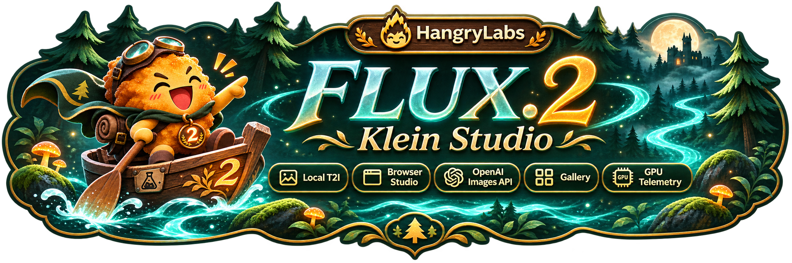

<p align="center"></p>

<p align="center"><a href="https://github.com/hangry-labs/flux2-klein-studio/blob/main/docs/dockerhub.md">English</a> · <a href="https://github.com/hangry-labs/flux2-klein-studio/blob/main/docs/dockerhub.nb.md">Norsk bokmål</a> · <a href="https://github.com/hangry-labs/flux2-klein-studio/blob/main/docs/dockerhub.pl.md">Polski</a> · <a href="https://github.com/hangry-labs/flux2-klein-studio/blob/main/docs/dockerhub.ja.md">日本語</a> · <strong>简体中文</strong> · <a href="https://github.com/hangry-labs/flux2-klein-studio/blob/main/docs/dockerhub.es.md">Español</a></p>

# FLUX.2 Klein Studio

通过 FLUX.2 Klein 4B 在本地生成图片，用指令修改图片、填充绿色区域并创建特写。一个 Docker 容器提供浏览器界面、OpenAI 兼容图片 API 和 MCP。

当前开发版本与更新历史请参阅英文主文档。 [English](https://github.com/hangry-labs/flux2-klein-studio/blob/main/README.md#version-history).

## 快速开始

需要支持 NVIDIA GPU 的 Docker，以及 NVFP4 运行环境支持的 Blackwell GPU。目前已在 16 GiB 显存的 RTX 5070 Ti 上测试，尚未对其他 GPU 进行本地验证。更大图片和更多参考图需要更多显存。

```shell
docker run -d --name flux2-klein-studio --restart unless-stopped --gpus all --init -p 127.0.0.1:7860:7860 -v flux2_klein_studio_data:/app/persistent hangrylabs/flux2-klein-studio:v1.0.0@sha256:276d5a25e347107f0670aad9a6b3a61098d072e504502391fbea8f5575a246ae
```

打开 **http://localhost:7860/zh**，在顶部选择界面语言。浏览器会记住语言偏好，但指定语言的 URL 优先。切换语言不会刷新页面，会保留文字、图片和当前工作。

### 更小下载：tiny

```shell
docker run -d --name flux2-klein-studio --restart unless-stopped --gpus all --init -p 127.0.0.1:7860:7860 -v flux2_klein_studio_data:/app/persistent hangrylabs/flux2-klein-studio:v1.0.0_tiny@sha256:0278135ce5fece29da9f6379add9dc2d9c137742dbcea050f9a772f888980c59
```

标准镜像包含固定版本的主模型，拉取镜像后可离线生成。tiny 在首次使用时下载模型及兼容内核。请选择其中一种，并保留同一个数据卷。风格适配器在首次使用时单独下载；使用标准镜像时，需先通过 `-e STUDIO_OFFLINE=0` 启用网络加载。

## 功能

- 根据描述生成正方形、纵向、横向和全景图片。
- 编辑图片，或在基础模型中使用最多四张有序参考图。更多视角不保证外观完全一致。
- 选择像素艺术、Koni Anime 或 NASA 太空概念艺术。服务器添加固定触发词，你只需描述图片。
- 用纯绿色（`#00FF00`）涂画待填充区域，或扩展画布。红色矩形用于生成式放大，并可基于结果继续。
- 下载 PNG、无损 WebP 或 JPEG。可选保存至图库，复用参数，并删除已保存文件。
- 查看 GPU 状态，调整模型空闲时间，以及控制智能体可用的图片尺寸。


## 生成与修改

建议从 1024×1024、四步开始。随机种子默认开启；关闭后可使用固定种子，在已验证的 GPU 和软件环境中用相同设置重现结果。第一个任务加载模型，后续任务复用权重。**发送到修改**将结果作为参考图打开，**使用此结果**可从新图片开始下一轮修改。

绿区填充和红框放大只使用一张参考图。它们也可能改变未标记区域或生成新的细节。像素艺术的背景为 RGB，并非真正透明。界面语言不会翻译你的描述或模型的固定英文触发词，也不保证各种提示词语言具有相同图片质量。

## 文件与显存

将 `flux2_klein_studio_data` 数据卷挂载到 `/app/persistent`，以保留模型、缓存、设置和已保存结果。替换容器时请复用同一数据卷。未选择保存到图库时，结果为临时文件，会在重启或被移出 100 项预览保留范围时删除。已保存结果仅在主动删除时移除。删除数据卷可能同时丢失缓存和已保存结果。

所有模型组件都驻留在 GPU，不向 CPU 或磁盘卸载。默认在最后一个任务结束后保留权重五分钟。未使用的工作显存会自动释放，也可在“系统”中立即释放。尺寸表是纯文生图的参考测量，不保证每种编辑任务都能装入显存。

## 应用与智能体

Images API: `/v1` · MCP: `/mcp/` · [简明使用指南](https://github.com/hangry-labs/flux2-klein-studio/blob/main/docs/zh/README.md).

## 隐私与条款

图片生成在本地执行。只有主动选择保存到图库时，才会持久保留结果和提示词；首次下载需要网络。请将端口限制在 localhost，或使用合适的认证代理。`STUDIO_API_KEY` 保护 `/v1` 和 `/mcp`，不保护本地浏览器 API。请使用获得必要授权的参考图，不要将生成图片当作真实记录。

应用代码采用 Apache-2.0。模型、适配器和依赖保留各自条款。请参阅 LICENSE、NOTICE 和 THIRD_PARTY.md；应用许可不取代组件条款。

[项目概览](https://github.com/hangry-labs/flux2-klein-studio/blob/main/README.zh.md) · [文档](https://github.com/hangry-labs/flux2-klein-studio/blob/main/docs/zh/README.md) · [LICENSE](https://github.com/hangry-labs/flux2-klein-studio/blob/main/LICENSE) · [NOTICE](https://github.com/hangry-labs/flux2-klein-studio/blob/main/NOTICE) · [THIRD_PARTY.md](https://github.com/hangry-labs/flux2-klein-studio/blob/main/THIRD_PARTY.md).
